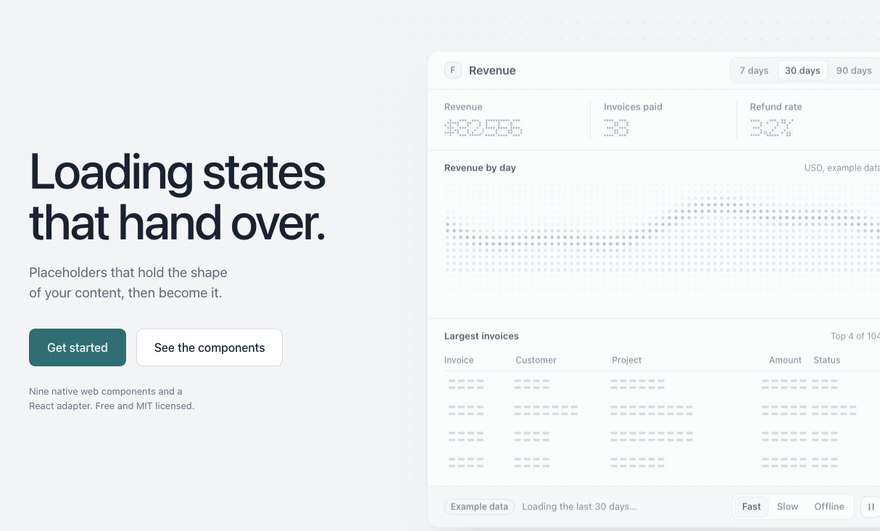
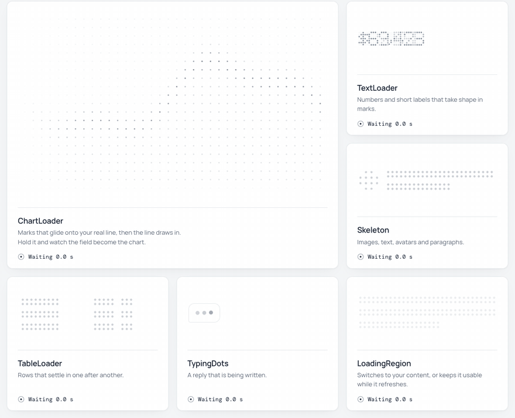

<div align="center">

<a href="https://dotquilt.dev">
  <picture>
    <source media="(prefers-color-scheme: dark)" srcset=".github/assets/logo-dark.svg">
    
  </picture>
</a>

# Dotquilt

**Loading states that hand over.**<br>
Skeleton loaders that hold the shape of your content, then become it.

[Website](https://dotquilt.dev) · [Docs](https://dotquilt.dev/docs/) · [Components](https://dotquilt.dev/docs/components/skeleton/) · [Examples](https://dotquilt.dev/examples/) · [Playground](https://dotquilt.dev/playground/)

[](https://www.npmjs.com/package/dotquilt)
[](https://www.npmjs.com/package/@dotquilt/react)
[](https://github.com/b4rb13/dot-loaders/actions/workflows/quality.yml)
[](LICENSE)


</div>

<br>

<a href="https://dotquilt.dev">
  <picture>
    <source media="(prefers-color-scheme: dark)" srcset=".github/assets/hero-dark.gif">
    
  </picture>
</a>

<br>

Dotquilt is a set of loading placeholders made of small marks. When your data arrives, the marks don't vanish: they travel to its real shape. Each skeleton line grows or shrinks to the length of your text, a number's marks take the shape of its digits, and a chart's marks glide onto your line. Then the content wipes in as they leave, in about a second.

- **Native Web Components** with no runtime dependencies, for any framework or none.
- **A React 19 adapter** with server rendering and clean hydration.
- **Accessible by default.** Pending content is inert and hidden from screen readers, focus is kept, reduced motion swaps content in at once, and forced-colours mode shows a clear outline.
- **Calm.** The idle glow stops after four seconds. `delay` and `min-display` keep fast loads from flickering.
- **Strict CSP.** No inline style attributes: allow the stylesheets with a nonce or hashes, or serve them as files.
- **Only what you use.** Each component has its own entry point and registers itself on demand.

> [!NOTE]
> Dotquilt is in alpha (0.x): the API may still change before 1.0. Feedback and issues are very welcome.

## Install

```bash
npm install dotquilt
```

For React:

```bash
npm install @dotquilt/react dotquilt
```

## Quick start

Wrap the content that loads in a region, give it a placeholder in its shape, and set it ready when the data arrives.

```html
<dotquilt-region state="pending" aria-label="Revenue">
  <dotquilt-skeleton-text slot="placeholder" lines="3"></dotquilt-skeleton-text>
  <div id="revenue"></div>
</dotquilt-region>

<script type="module">
  import { registerLoadingRegion } from 'dotquilt/region';
  import { registerSkeletonText } from 'dotquilt/skeleton';

  registerLoadingRegion();
  registerSkeletonText();

  const region = document.querySelector('dotquilt-region');
  const data = await fetch('/api/revenue').then((response) => response.json());
  document.querySelector('#revenue').textContent = data.summary;
  region.update({ state: 'ready' });
</script>
```

The same in React:

```tsx
'use client';
import { LoadingRegion, SkeletonText } from '@dotquilt/react';

export function Summary({ data }: { data: Revenue | null }) {
  return (
    <LoadingRegion
      aria-label="Revenue"
      state={data ? 'ready' : 'pending'}
      placeholder={<SkeletonText lines={3} />}
    >
      {data && <RevenueCard data={data} />}
    </LoadingRegion>
  );
}
```

Your app owns the request. The region only needs to know whether the data is `pending`, `refreshing` (the content stays visible and usable) or `ready`.

## Components

<picture>
  <source media="(prefers-color-scheme: dark)" srcset=".github/assets/family-dark.gif">
  
</picture>

| Component | Element | Use it for |
| --- | --- | --- |
| [LoadingRegion](https://dotquilt.dev/docs/components/loading-region/) | `<dotquilt-region>` | Wraps content: a placeholder while pending, a refresh cue while refreshing, a handoff when ready |
| [Skeleton](https://dotquilt.dev/docs/components/skeleton/) | `<dotquilt-skeleton-block>`, `-line`, `-circle`, `-text` | Images, lines, avatars and paragraphs |
| [TextLoader](https://dotquilt.dev/docs/components/text-loader/) | `<dotquilt-text-loader>` | Numbers and short labels that take shape in marks |
| [ChartLoader](https://dotquilt.dev/docs/components/chart-loader/) | `<dotquilt-chart-loader>` | Line, bar and scatter charts: marks glide onto your real data |
| [TableLoader](https://dotquilt.dev/docs/components/table-loader/) | `<dotquilt-table-loader>` | Tables: each cell's marks gather into its text |
| [TypingDots](https://dotquilt.dev/docs/components/typing-dots/) | `<dotquilt-typing-dots>` | A reply that is being written |

Every loader comes in dot, dash and square marks, in light and dark, themed with `--dotquilt-*` custom properties. Try them all in the [playground](https://dotquilt.dev/playground/).

## Guides

- [Installation](https://dotquilt.dev/docs/installation/) and [theming](https://dotquilt.dev/docs/theming/)
- [React and Next.js](https://dotquilt.dev/docs/guides/react/)
- [Server rendering](https://dotquilt.dev/docs/guides/server-rendering/)
- [Content Security Policy](https://dotquilt.dev/docs/guides/csp/)
- [Motion and accessibility](https://dotquilt.dev/docs/guides/motion/)
- [Custom animations](https://dotquilt.dev/docs/guides/custom-animations/)

## Examples

- [Examples gallery](https://dotquilt.dev/examples/): a dashboard and recipes for real product screens, each with its code.
- [`examples/next`](examples/next): a Next.js App Router project with server rendering, hydration and a client-side navigation.

## Repository

| Path | What it is |
| --- | --- |
| [`packages/core`](packages/core) | `dotquilt`: the native Web Components runtime, framework-free |
| [`packages/react`](packages/react) | `@dotquilt/react`: the React 19 adapter, with server rendering |
| [`apps/site`](apps/site) | [dotquilt.dev](https://dotquilt.dev): docs, examples and the playground (Astro + Starlight) |
| [`examples/next`](examples/next) | A Next.js App Router example |
| [`design`](design) | The design spec and tokens |

## Contributing

Issues and pull requests are welcome. [CONTRIBUTING.md](CONTRIBUTING.md) covers setup, tests and how changes are made.

## License

[MIT](LICENSE)
