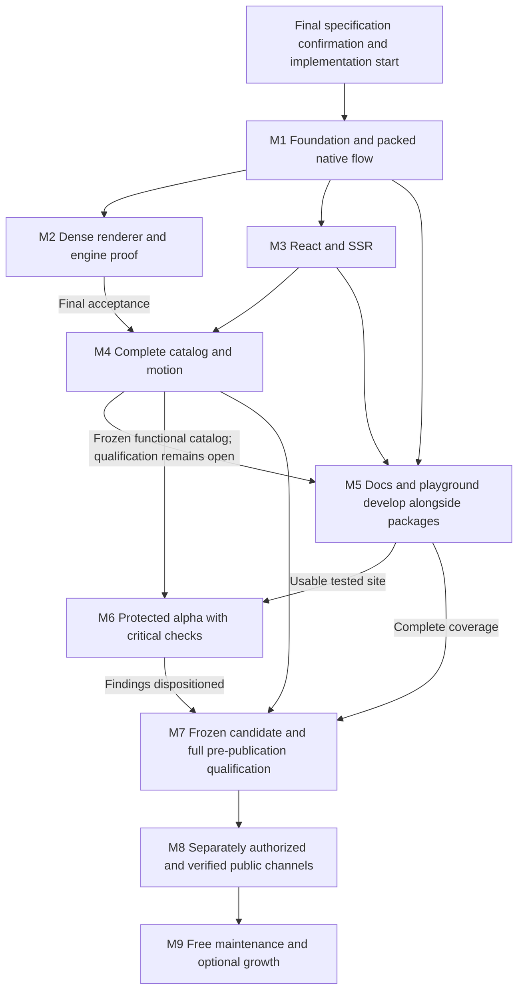

# Dotquilt implementation roadmap

> **Superseded (2026-11-18):** current sequencing lives in [AUDIT.md](../AUDIT.md). This roadmap is kept for history; links into `docs/implementation/**` point to files now archived outside the repo.

**Default keyboard navigation repaired:** [#39 packet](implementation/m5/tab-order-progress.md) restores natural ready/refresh descendant Tab order, while an owned temporary destination preserves visible replacement focus handoff. Caller role/tabIndex remain authoritative; no API/animation change. Only one native controller/two React defaults plus one necessary website Preflight correction change; rest refrozen to core `3ab8232b387b` / React `003c3de65c2b`, old freezes/tarballs retained. Final402scoped browser passes/27controlledSSR comparisons; Table external adapter passes preserved. #39 closes its local bug scope. M2/M4/M5/#32/#34/#35 remainOPEN, all sixM5gatesPARTIAL, optimizationPAUSED, renderersPROVISIONAL and npmDISABLED. Manual/floor/device/exhaustive framework/performance/release gates remain. Next: owner walkthrough of docs/complete examples and actual loaders.

**Focus indication correction:** [#38 packet](implementation/m5/focus-progress.md) keeps ordinary clicks quiet and keyboard/before-hide focus transfers visible. Only two native sources and their output change; necessary website selectors defer to the package treatment. The remainder is refrozen to core `00eedbc20658` / React `05258976cbf3`, preserving the old freeze/tarballs and all22public declarations. Final186scoped browser cells/27exactSSR comparisons, units/types/lint/build pass; Table adapter external passes remain. Separate original default descendant tab entry is OPEN under #39. #38 closes only this correction; M2/M4/M5/#32/#34/#35/#39 remain OPEN, all sixM5 gates PARTIAL, optimization PAUSED, renderers PROVISIONAL and npm DISABLED. No numerical/manual/device/whole-site waiver or release action.

**Local search and Fumadocs reading frame:** [Search checkpoint](implementation/m5/search-progress.md) adds the standard DocsLayout/DocsPage reading frame, stable side rails and mobile navigation in the same app, plus on-demand local search over 43 pages, 628 records and 175 valid links. Homepage/playground source and the frozen 303-file/two-tarball runtime remain preserved. The final 132 focused browser cells pass. The earlier 744-cell run retains its 702 passes and 42 failures: 30 new docs fallback/navigation failures are repaired in the final repeats, and 12 existing #34/#35 failures remain held. Build, types, 23 units, 489-file lint and parity checks pass within their recorded scopes. The reviewer scored the one visual fix resolved; generic reviewer/documenter substitutions are disclosed. #37 is complete for this local slice. #32/M5/M2/M4/#34/#35 stay OPEN, all six M5 gates PARTIAL, optimization PAUSED, renderers PROVISIONAL and npm DISABLED. Version/archive, exhaustive coverage, actual floor/device/manual/full-CSP/field-performance and release gates remain. No second app, cloud transfer, deployment, publication or visibility change.

## Current direction — 2026-10-22

**Animation gallery and complete React usage:** [Gallery checkpoint](implementation/m5/gallery-progress.md) adds 24 canonical actual React components across all 9 exports/all 19 factories at `/docs/gallery`. State/handlers/content/sizing and chart/table geometry/row targets are included; preview and highlighted/copied source share the same files. Nine reference React tabs now show complete default starters; richer current-settings applications and Native composition/full-app presentation remain. Scoped 93 Gallery/243 reference/72 isolated passes and 24 ready-onlySSR checks are separate from the earlier 396/408 other-website run (only known #34/#35). Final 9 repeated recovery checks verify both reviewer fixes; bounded verdict and generic substitutes documented. Runtime 303-file/two-tarball freeze and homepage/playground/style/dependency/generator preservation pass. #36 closes for local implementation; #32/M5/M2/M4/#34/#35 stay OPEN, all six M5 gates PARTIAL, optimization PAUSED, renderers PROVISIONAL, npm DISABLED. Local search/version/archive and actual floor/device/manual/fullCSP/performance/whole-M5 qualification remain. No external deployment/publication/export action.

**Shared reference code panels:** all nine component references now use the accepted Fumadocs code-block/tab pattern with colored server syntax highlighting, including the Native no-JavaScript fallback. The same mounted preview owner/cycle and complete-file generator remain. [Exact packet](implementation/m5/reference-code-progress.md) records 243/243 focused and 396/408 other website cells (only existing #34/#35), plus 24 equivalent-fixture repeats. Build/types/units/lint, 303-file/two-tarball freeze, 783 generated files and canonical/displayed guide-source parity pass. Homepage/playground/global styles/fonts/dependencies/design artifacts stay exact. Bounded visual SHIP uses disclosed generic review/documentation substitutes; all six M5 gates PARTIAL. #32/M5/M2/M4/#34/#35 stay OPEN, optimization PAUSED, renderers PROVISIONAL and npm DISABLED. Gallery/search/version/archive and remaining actual floor/device/manual/full-CSP/performance/whole-M5 qualification remain subsequent work. No runtime/cloud/deployment/distribution/visibility/publication action.

**TextLoader code-block/tab pilot:** the owner-authorized Fumadocs UI 16.17.7 pilot lives only on the TextLoader reference, with server-highlighted React/Native composition tabs, original-string copy/fallback, keyboard scrolling and unchanged complete-file disclosures. The same preview owner/cycle stays mounted. [Exact checkpoint](implementation/m5/code-tabs-progress.md) records final 36/36 scoped cells, earlier 27/27 pilot cells and pre-final broader 492/504 with only #34/#35 held. Runtime 303-file/two-tarball freeze, 783 generated files, homepage/playground/global CSS/fonts/design artifacts and prior guide sources remain exact. Bounded visual review is SHIP; generic substitutions and the final source-only noJS focus scope are disclosed. All six M5 gates PARTIAL; #32/M5/M2/M4/#34/#35 OPEN, optimization PAUSED, runtime FROZEN, renderers PROVISIONAL and npm DISABLED. Owner review/any broader UI adoption, Gallery/search/version/archive and whole qualification remain subsequent work; no cloud/deployment/distribution/visibility/publication.

**Asset/font/pointer/recovery continuation:** website-only Quickstart/catalog admission retains useful static content and disables loading until required CSS and observer capabilities are available; reload keeps route/settings and failed address writes retain edits. [Exact packet](implementation/m5/resilience-progress.md) records final 99/108 focused checks (nine held pointer cases in [M4 #35](https://github.com/b4rb13/dot-loaders/issues/35)) and pre-correction 408/411 broader checks (three unchanged #34 misses). Build/types/units/lint pass; 303 frozen files/two tarballs and prior source/generated files remain exact. The scoped recovery underline passed its scored visual review. [Fumadocs code blocks/tabs are recommended](implementation/m5/code-preview-assessment.md) for a future bounded preview/code pilot; nothing installed. All six M5 gates PARTIAL; #32/M5/M2/M4/#34/#35 OPEN, M2 optimization PAUSED, runtime FROZEN, renderers PROVISIONAL and npm DISABLED. Remaining actual device/manual/floor qualification, #34/#35, Gallery/search/version/archive and whole-M5 acceptance stay open.

**Semantic/mixed/provider continuation:** three new Core+MDX guides share one complete native/React report application. It exercises real chart/table geometry, explicit current row targets, automatic/explicit shared choreography, nested text ownership and seven provider/fallback cases. [Exact checkpoint](implementation/m5/semantic-guides-progress.md) records 171/171 standalone and 63/63 final-guide checks, 408/411 broader website with the same three #34 misses, source parity and unchanged 303-file freeze. The frozen ASCII-only table projection is described honestly with original international content preserved; no contract amendment or mixed-SSR qualification. Homepage/playground/styles/dependencies remain intact. Next finish #32's asset/font/pointer/failure matrix and open admission/recovery gaps, then Gallery/local search/version/archive and whole qualification. All six M5 gates PARTIAL; #32/M5/M2/M4/#34 OPEN, M2 optimization PAUSED, renderers PROVISIONAL and npm DISABLED.

**React/Next/SSR/CSP guide continuation:** four new Core+MDX guides link to two complete standalone applications using the exact private artifacts. The React/Bun app demonstrates real ready/pending SSR and external/nonce/hash styles; the production Next app adds server children, Suspense and document-policy retention through client navigation. [Checkpoint and exact evidence](implementation/m5/integration-guides-progress.md) record current-pinned builds,57 standalone browser cells, guide/static/mobile/complete-file checks and all open limits. The pre-definition pending-child gap discovered in the frozen adapter is explicitly contained by application CSS in the examples and [retained in open M4](https://github.com/b4rb13/dot-loaders/issues/18#issuecomment-6328304943); no contract amendment or runtime fix is implied. Existing homepage/playground and303-file freeze remain. Continue #32 with deeper semantic/mixed/provider examples and remaining failure/asset/font/pointer coverage, then Gallery/search/version/archive work and whole qualification. All six M5 gates PARTIAL; #32/M5/M2/M4/#34 OPEN, M2 optimization PAUSED, renderers PROVISIONAL and npm DISABLED.

**All-reference MDX/dark continuation:** the owner authorized the remaining eight references and dark docs/playground. All nine references and Quickstart now use the Core+MDX collection; four trusted local MDX includes retain common guidance, and typed facts/live examples remain in their existing modules. The static dark default preserves shell geometry, system typography, native controls and custom homepage/workbench behavior. [Exact checkpoint](implementation/m5/reference-migration-progress.md) records114/114 reference/theme/binding checks,345/348 distinct combined website cells with three unchanged #34 misses,54 matching prose sections and unchanged303-file/two-tarball/783-generated-file freeze. The original340/345 run and two corrected test assumptions remain archived. All six M5 gates stay PARTIAL. Next deepen semantic/mixed/framework/pending-SSR/CSP examples and resolve the open admission/recovery gaps before Gallery/search/version/archive work and final qualification. This supersedes the earlier pilot-only/no-dark scope for this migration only. #32/M5/M2/M4/#34 OPEN; M2 optimization PAUSED; renderers PROVISIONAL; npm DISABLED.

**Fumadocs pilot:** the owner authorized Core + MDX for one guide and one component reference. Quickstart and TextLoader now use repository MDX with a server-only Core source and heading-derived contents, retaining their URLs, anchors, live workbenches, complete files and typed API data. [Pilot/evidence](implementation/m5/fumadocs-pilot.md) and [authoring notes](implementation/m5/fumadocs-authoring.md) define the bounded scope. This supersedes the earlier proposal-only/no-install status; remaining references, deeper guides, Gallery/search/archive/version work and all six whole-M5 gates remain open. The custom homepage/playground,303-file freeze, M2 pause, M2/M4/#34 open, provisional renderers and npm-disabled boundaries remain. No failed recovery gate or broader migration is waived/authorized by the pilot.

**Fallback/lifecycle progress:** [#32](https://github.com/b4rb13/dot-loaders/issues/32) now supplies useful static specimens until required component CSS passes admission, with explicit failure/reload paths and preserved code/settings. [The scoped packet](implementation/m5/lifecycle-progress.md) records the declared current-engine fallback, motion-window, supersession, visibility and client-navigation checks; all six whole M5 gates remain PARTIAL. Remaining fonts/pointer/framework/pending-SSR/CSP/deeper examples and full qualification stay open. [Fumadocs Core + MDX is recommended for a bounded pilot](implementation/m5/fumadocs-assessment.md) before search/archive work; no dependency or migration is approved/installed. Runtime freeze, M2 pause, M2/M4 open, provisional renderers and npm-disabled boundaries remain unchanged. Result:231/234 local website cells pass; three WebKit JavaScript retry failures remain HELD in [#34](https://github.com/b4rb13/dot-loaders/issues/34). The unproven fresh-tab workaround is rejected; no failed gate is waived.

**Typed authoring progress:** [#32](https://github.com/b4rb13/dot-loaders/issues/32) now has19 first-party option editors/reference tables,5 typed custom families and6 local preset kinds. [The exact packet](implementation/m5/options-progress.md) records129 browser cells,58 complete native/React profiles,14 units/579 assertions,783 identical generated files and the unchanged303-file freeze. Next finish the remaining lifecycle/failure recovery and framework/pending-SSR/CSP coverage; deeper semantic/mixed examples and full M5 qualification remain open. All pause/freeze/privacy/npm boundaries remain unchanged.

**Catalog progress:** [#32](https://github.com/b4rb13/dot-loaders/issues/32) now implements nine component references and matching real playgrounds, three chart geometries, selected rich recipes, bounded share state and docs-to-playground transport. [The exact catalog packet](implementation/m5/catalog-progress.md) records102 local-engine browser passes,28 complete native/React profiles,322 byte-identical generated files and the unchanged runtime freeze. #32 remains OPEN for per-factory numeric/custom/preset and remaining failure/lifecycle/framework/SSR/CSP coverage; [all six gates/33 scenarios](implementation/m5/coverage.json) retain explicit incomplete scope. Finish that coverage next, then Gallery/local search/version navigation. Homepage visual acceptance and its unverified comparison remain separate.

**Homepage priority update:** on 2026-10-22 the owner accepted the current **Dot Gallery** visual result and continuation to catalog pages, retaining its automated caption comparison unverified. #33 closes at that scoped acceptance; [the exact owner record](implementation/m5/homepage-acceptance.json) supplements the unchanged earlier evidence. The owner selected **The Dot Gallery**. Its elegant black/white/gray homepage is implemented at `/`, with real text/chart/table replays and preserved Guide/Workbench at `/docs` and `/playground`. [Homepage #33 and its exact review/check status](implementation/m5/homepage-progress.md) lead M5; a held automated comparison is not treated as a pass. Earlier colorful mockups remain archived. [Catalog/rich-motion pages #32](https://github.com/b4rb13/dot-loaders/issues/32) follow the homepage slice. This changes the website sequence only; all runtime freeze/qualification/publication boundaries below remain.

The owner paused M2 optimization and authorized **[M5: website, docs and playground #19](https://github.com/b4rb13/dot-loaders/issues/19)**. The current runtime is frozen under [303 exact hashes](implementation/m5/runtime-freeze.json); root/app tooling and website content may evolve. M2 #16 and M4 #18 remain OPEN, renderers PROVISIONAL and npm publishing DISABLED. The [deferred work index](implementation/m2/deferred-work.md) links eleven open GitHub tasks covering all remaining performance/size/qualification obligations, with exact measurements, evidence and acceptance criteria. Deferral is not a waiver or public-release approval.

Completed the first slice **[Quickstart → real preview → complete example #20](https://github.com/b4rb13/dot-loaders/issues/20)**; next [expand real catalog/rich-motion pages #32](https://github.com/b4rb13/dot-loaders/issues/32), followed by the Gallery, local search and version navigation. The [first M5 slice](implementation/m5/progress.md) is implemented locally and separately verified; full M5 acceptance remains open. Follow the approved Guide/Workbench/Gallery direction and #11's six gates/33 acceptance scenarios. Website implementation does not authorize cloud testing, distribution, deployment, source visibility or npm publication. No M2 runtime engineering or broad resampling during this website slice.

The checkpoint notes below retain historical scopes; earlier statements that M5 needed authorization are superseded by this section. M6–M9 and their independent approvals/gates remain subsequent work.

Latest M2 study: [handoff setup and fresh animation-query study](implementation/m2/handoff-tail-progress.md) adopts **no runtime change**. An owner-subtree scan cuts query count threefold but does not clearly reduce sampled query time, adds six active/nine phase flags and loses idle whole-work consistency. Restoration also exposes a pseudo-element false-positive and the experiment's mistaken expectation; those three original green cells are invalid acceptance assertions. Full candidate 3/20 sampling (138 traces), 300 cleanup cycles/18 sparse heap cells and all negative evidence are retained separately. Exact core `ac9c33b4e372` / React `39a0d1b6bfb2`, all 93 source/205 output files and six Table passes are restored, with 396 fresh scoped browser passes, corrected effect regression cases, identical SSR and clean reproduction. Candidate faster setup/p99 values do not qualify restored bytes; prior performance/reference/manual/raster/size holds remain. M2/M4 OPEN, renderers PROVISIONAL, npm DISABLED.

Latest M2 continuation: [startup/setup and handoff lifetime optimization](implementation/m2/startup-handoff-progress.md) retains private core `ac9c33b4e372` / unchanged React `39a0d1b6bfb2`. Two private dense modules retain paused SVG/active Canvas writers and bounded buffers, revalidate admission with existing-reservation credit, and avoid a discarded idle bitmap on ready capture. All 93 source hashes, 22 public declarations, styles/adapter outputs/three baselines and recipe/controller/scheduler/observer behavior are checked; only two private sources change. Fresh 858 scoped browser passes, 300 exact command/reveal frames, 300 cleanup cycles and 18 sparse heap cells pass;299/300 raster pairs are exact, with 8 edge-pixel differences held. All 28 prior size fields and six Table adapter caps pass (worst 2,043/2,048 B), while ten hard groups/eight growth identities remain; complete external root Chart/Table add 138/135 B without a waiver. Full 3/20 retains 138 traces: idle rendering/whole-work now pass locally; list rendering passes 19/20 but whole-work 16/20 and long tasks remain held; handoff still fails. Dashboard init 32.0/33.0 ms is below 40 ms, list init 125.426/100 ms and setup 19.143/8 ms still miss. Handoff rendering/whole p99 8.857/12.403 ms improve but remain high;0 new active /1 idle-setup CPU-bound phase flag, all older flags, GC/raster/reference/floor/manual holds remain. M2/M4 OPEN, renderers PROVISIONAL, npm DISABLED.
Latest M2 continuation: [renderer-neutral capture and bounded Canvas integration](implementation/m2/renderer-integration-progress.md) retains a private development pair, core `7978943ec314` / React `39a0d1b6bfb2`. Default chart ridge/morph and Table idle/rows gain visibility-first, bounded Canvas with rich SVG fallback; other chart idles, Text/custom recipes keep SVG. Numeric immutable capture, optional capacity preflight, context-loss recovery and first-frame reveal fixes preserve frozen public declarations/recipe math and all six Table adapter passes (worst 2,044/2,048 B). Fresh 840 scoped browser passes, 300 exact command/reveal comparisons, 300 cleanup cycles and 18 sampled heap passes are recorded. All three full 3/20 rendering/whole-work cells still fail; rendering p95/p99 is 4.212/5.666, 3.745/9.855 and 3.541/5.288 ms. Two handoff active-tail and 50 initialization/setup comparison flags, new dashboard init misses, 19.414/8 ms handoff setup, 154.626/100 ms list init, list long tasks and 159 differing raster pairs remain held alongside every older finding. All 28 passing size fields survive; ten hard groups/eight Typing growth identities remain, without cap/baseline/waiver changes. React source/JS stays unchanged; its packaged chart/table CSS changes. Local timings, sparse heap and command equality do not grant raster/owner/reference/floor/manual/GPU acceptance. M2/M4 OPEN, renderers PROVISIONAL, npm DISABLED.
Latest M2 study: [renderer and measurement comparison](implementation/m2/renderer-study-progress.md) leaves the exact shipping core `a6426cc8092a` / React `25aff5bd5e9e` and all 90 source/199 output files unchanged. An isolated current-SVG versus Float64 Canvas graph retains 120 measured pairs/eighteen warmups/276 traces, 300 exact command/geometry/reveal frame comparisons and 600 PNGs. Canvas sharply reduces active work and the gain persists without detailed tracing; only dashboard idle passes both local numeric rules. Handoff/list per-run gates, setup/list-init/long tasks, twelve diagnostic phase flags and 205 differing raster pairs remain held. A clean DPR 2 list audit exposes bitmap-denial/fallback persistence (294 errors/24 missing visible-rich-painter observations); this blocks Canvas adoption. Fresh 234 native browser cases, root/package/clean checks, all six Table adapter passes (worst 2,047 B) and 28 retained size fields pass; ten hard groups/eight growth identities remain unchanged. Recommend a private renderer-neutral capture/shared engine context and visibility-first bounded bitmap admission before any production Canvas integration. Prototype complete memory/custom/copy/SSR/CSS/device/manual/owner qualification remains open; prior shipping checks retain their original scopes. M2/M4 OPEN, renderers PROVISIONAL, npm DISABLED.

Latest M2 continuation: [bounded active-paint formatting](implementation/m2/paint-allocation-progress.md) retains one private painter change in core a6426cc8092a / unchanged React 25aff5bd5e9e, as an unaccepted development optimization. Four alternating installed-graph profiles lower sampled active allocation 514,098,504→388,147,252 B (~24.5%); explicit numeric formatting 175→51 preserves exact SVG, with fresh commands/finite/getter/cap/revocation rules, frozen API/motion/accessibility and the other 89 modules unchanged. Fresh 1,086 browser passes, identical SSR/clean reproduction, all six complete Table adapter passes (worst 2,047/2,048 B), 28 preserved gate fields, 300 cleanup cycles/nine checkpoints and 18 sparse heap passes are scoped to this exact pair. Full 3/20 keeps 138 traces; rendering p95/p99 is 6.450/13.039, 6.675/8.557 and 10.004/16.186 ms, with all rendering/whole-work gates still failed. Setup 17.063/8 ms, list init 199.602/100 ms and list long tasks remain held. There are 0 new active and 4 new list static-teardown phase flags (busy p95 6.056→6.845 ms), with no recorded GC in selected p95/max static teardown intervals; idle/list GC tails and every historical flag remain held without causal/reference verdict, waiver or baseline advance. Ten default size groups/eight existing growth identities and physical/floor/manual/equal-quality qualification remain open. M2/M4 OPEN, renderers PROVISIONAL, repository/packages PRIVATE, npm DISABLED.

Latest M2 study: [static teardown traversal and exact restoration](implementation/m2/teardown-retention-progress.md). No production change is adopted. The iterator-free observer-release candidate 11bce1886a0d has 1,083 scoped browser passes, identical SSR/clean reproduction, six Table adapter passes, 300 cleanup cycles and 18 sparse heap passes, but adds four held list static teardown flags (busy p95 6.056→7.152 ms) despite ~28% lower sampled teardown allocation. Selected p95/max teardown intervals contain no recorded main-thread GC; no causal verdict or waiver. A document-owned wrapper follow-up loses the selective Table adapter cap at 2,051/2,048 B and is rejected at staging. All 90 production sources/199 compiled outputs and exact core aaa93f20cb37 / React 25aff5bd5e9e are restored, with 228 fresh focused native passes, root quality/boundary/packed/clean checks and all six complete Table adapter passes (worst 2,048/2,048 B). The experimental iterator-count test is preserved only in the sealed rejected packet. No new timing or memory run is promoted to the unchanged retained runtime; original eight teardown flags, GC tails, all older findings and ten default size groups/eight growth flags stay held. M2/M4 OPEN, renderers PROVISIONAL, repository/packages PRIVATE and npm DISABLED.

Latest M2 continuation: [minimal listener cleanup allocation](implementation/m2/list-lifetime-progress.md) retains only abort(null) and its explanatory comment in private EventElement. Native signal ownership/capture/reconnect semantics, the other 89 modules, frozen API/motion/accessibility, declarations/styles and three baselines stay intact. Exact core aaa93f20cb37 / React 25aff5bd5e9e has 1,080 scoped browser passes, exact SSR/clean reproduction, six Table adapter complete-CSS passes (worst 2,048/2,048 B), 300 cleanup cycles/nine checkpoints and 18 sparse heap passes. The release-callback rewrite is superseded and preserved separately. Four alternating packed profiles reduce sampled teardown allocation, but do not establish GC-tail/reference/whole-render acceptance. Full 3/20 retains 138 traces; 0 active and 8 phase comparison flags versus canonical frame-lifetime, all absolute/initialization/setup/list-long-task misses and every original/confirmation/older finding remain held. Ten default size groups/eight growth flags and physical/floor/manual/equal-quality obligations stay open. M2/M4 OPEN, renderers provisional, repository/packages PRIVATE and npm disabled.

Latest M2 continuation: [balanced handoff/list regression confirmation](implementation/m2/tail-confirmation-progress.md) keeps all 90 production sources and the exact core 964399241e10 / React 25aff5bd5e9e unchanged. One predeclared symmetric, interleaved comparison retains 120 measured pairs, 18 warmup pairs and 276 raw traces across both builds/three workloads. It records 0 active-metric and 6 phase-metric conjunction flags; the original four active flags and every older finding stay held, with no waiver, baseline advance or causal/reference verdict. GC overlaps, absolute rendering/whole-work/setup/list-init/long-task misses remain explicit. Fresh 336 focused browser passes, exact SSR/clean reproduction and remeasured six Table adapter passes preserve frozen API/motion/accessibility/reconnect behavior. Ten default size groups/eight growth flags and physical/floor/manual/equal-quality qualification remain open. M2/M4 OPEN, renderers provisional, repository/packages PRIVATE and npm disabled.

The owner approved the complete launch specification and implementation handoff (Q1–Q11), including M1–M9 dependencies/exits, evidence requirements and operational prerequisites, on 2026-10-16 in [Approve the launch specification and implementation sequence](https://github.com/b4rb13/dot-loaders/issues/13). Planning is complete. These are delivery checkpoints, not single-session estimates or calendar commitments; completed scope is recorded separately below.

The [Wayfinder map](https://github.com/b4rb13/dot-loaders/issues/1) is the canonical decision index. Use the [launch specification's exact resolution links and explicit supersessions](planning/launch-specification-review.md) for the full API, environment, motion, accessibility, performance, documentation, governance and commercial contracts. This roadmap summarizes delivery; it cannot silently reduce those obligations. The earlier provisional roadmap is superseded by this accepted sequence.

M1 is complete for its scoped native slice ([completion packet](https://github.com/b4rb13/dot-loaders/issues/15#issuecomment-6221959345)); M3 is complete for its scoped SkeletonBlock/LoadingRegion React/SSR foundation ([evidence](implementation/m3/progress.md)). Neither establishes complete catalog or release readiness.

Latest M2 continuation: [frame membership allocation and Text cleanup](implementation/m2/frame-lifetime-progress.md) retains two private changes: one callback-membership array per stable cohort instead of per frame, invalidated on add/remove, and removal of the duplicate Text pointer reset. Frozen API/animations/accessibility/reconnect ordering, other 88 modules, 22 declarations/eight styles/three baselines stay unchanged. All six complete Table adapter passes survive (worst 2,043/2,048 B), with 1,074 scoped browser passes, exact SSR/clean reproduction, 300 cleanup cycles and 18 sampled heap passes. Full 3/20 static teardown is lower locally, but all rendering/whole-work cells still fail; handoff p99 and list p95 add four held active-metric flags, with every old/new phase finding retained. No end-to-end GC/timing/regression acceptance or causal/reference verdict is asserted. Ten default size groups/eight growth flags and all reference/floor/manual/equal-quality gates remain held. M2/M4 OPEN, renderers provisional, repository/packages PRIVATE, npm disabled.

Preceding M2 study: [static teardown and GC tails](implementation/m2/teardown-gc-progress.md) adopts no production change. The last-subscriber observer cleanup candidate passes 1,068 browser checks, exact SSR/clean reproduction, 300-cycle cleanup and 18 sampled heap cells, but adds held static-teardown increases and has no reliable benefit in alternating profiles; it is rejected. All 90 production sources/original test and exact preceding core 96b9f9b609c8 / React 25aff5bd5e9e are restored with 213 fresh focused browser passes, root quality/boundary/packed/clean checks and all six Table adapter passes (worst 2,046/2,048 B). Candidate full 3/20 results stay separate from the unchanged retained runtime's gc-handoff timing/memory packet. Frozen API/animations/accessibility/reconnect fix and all baselines/ceilings remain. Old/new flags, GC tails, timing/long tasks and reference/floor/manual qualification stay held. M2/M4 OPEN, renderers provisional, packages/repository PRIVATE, npm disabled.

Preceding M2 continuation: [GC tails and handoff preparation](implementation/m2/gc-handoff-progress.md) retains three private chart changes: invocation-local numeric style scratch and a line-only crest-column preparation pass. All six complete Table adapter passes survive (worst 2,046/2,048 B), with frozen public declarations, exact animation commands, cached writer/reconnect ordering and accessibility ownership preserved. Full 3/20 rendering p95/p99 is 6.739/14.951, 7.057/9.888 and 11.805/16.437 ms; all rendering/whole-work cells still fail. Handoff setup is 19.908/8 ms and list initialization 211.391/100 ms; list long tasks and nine static-teardown metric flags versus the immediate predecessor remain held, with every historical finding. Full 300-cycle cleanup/nine checkpoints and 18 active-heap cells pass locally (maximum residual 429,572 B). Profiling is attribution only; required reference/floor/manual/equal-quality evidence stays unverified. Ten default size groups/eight existing growth flags remain; no ceiling or baseline advances. M2/M4 OPEN, renderers provisional, npm disabled.

Preceding M2 continuation (2026-10-20): [circle-owned cached writer](implementation/m2/cached-writer-progress.md) recovers all six complete Table adapter passes without React changes (worst 2,046/2,048 B), preserving the reconnect fix, frozen API/motion/accessibility, Block/Typing and amended Region caps. The writer avoids redundant SVG writes without DOM reads and removes a separate cache object per dot. Fresh 3/20 dashboard idle/handoff/list collections improve p95 22–33% against the uncached pair and reduce list teardown versus the previous cache, but all rendering/whole-work numerical cells, list long tasks, 224.131/100 ms list init, 20.557/8 ms handoff setup and three elapsed-phase comparison flags remain held. Full 300-cycle cleanup/nine checkpoints and 18 active-heap cells pass locally. The exact packet distinguishes current scoped checks from required reference/manual/floor/equal-quality qualification and preserves earlier studies/baselines. Ten default size groups/eight growth flags remain; M2/M4 OPEN, renderers provisional, npm disabled.

Preceding continuation (2026-10-20): [Region’s owner-authorized 8 KiB amendment](https://github.com/b4rb13/dot-loaders/issues/9#issuecomment-6295086603) ends the Region-only byte campaign; its complete 6,420/6,411 B retained implementation now passes with >20% headroom. Size baselines, growth review and every other limit remain unchanged. [Fresh M2 rendering comparison](implementation/m2/rendering-resume-progress.md) evaluates an owned cached SVG writer against the same 3/20 catalog protocol. It improves local p95 rendering 23–31% but remains above targets, adds held tail/diagnostic findings and loses a Table adapter pass by 14 B. No runtime candidate is adopted: the exact retained pair, reconnect fix and all six Table adapter passes are restored. Continue rendering/init/handoff work with M2/M4 OPEN, renderers provisional and npm disabled.

M2 [#16](https://github.com/b4rb13/dot-loaders/issues/16) stays open. Its [retained exact-pair sampling checkpoint](implementation/m2/handoff-progress.md) records full local timing misses, passing scoped cleanup/memory/paused visuals and unresolved regression, candidate, reference and manual qualification. Those measurements keep their original package and are not promoted to subsequent M4 artifacts. The [closure checklist](implementation/m2/closure-checklist.md) remains binding. The owner has no approved reference devices; the earlier bounded BrowserStack attempt completed zero component assertions and remains historical.

M4 [#18](https://github.com/b4rb13/dot-loaders/issues/18) is feature-frozen and undergoing size/performance qualification. All nine native/current-React/static exports and their incremental skeleton/typing/text/chart/table rich recipes exist. The [functional checklist](implementation/m4/functional-checklist.md) separates delivered scopes, remaining API/custom/projection/mixed coordination and framework/SSR examples from later qualification. The current [preset checkpoint](implementation/m4/presets-progress.md) completes local family validation and default/override resolution with native/React/static paths. Existing and newly measured size/growth failures remain held under unchanged ceilings; the [earlier Table size work](implementation/m4/table-size-progress.md) and every prior exact artifact/baseline retain their original results. M4 cannot receive final acceptance until its functional and qualification obligations, including M2, pass. Renderers remain provisional and npm publishing disabled.

Latest M4 size continuation: [Table adapter complete CSS budgets and Region follow-up](implementation/m4/configuration-size-progress.md) retains a React-only primitive hydration snapshot, stable keyed stylesheet/host pairs and verified inert import placement. All six default/first-party/custom Table adapter measurements now pass the unchanged 2 KiB limit; default complete external increments are **2,043/2,034 B**, with only **5 B** worst-case optional headroom. Native source/artifact and SSR markup remain unchanged. Region complete external is still **6,419/6,411 B** against 6,144; native Table and other rich ceilings and eight growth flags remain held. No baseline, public API, motion or accessibility requirement changes. The ten retained default size failures prevent size completion; M2/M4 stay OPEN, renderers provisional and npm disabled.

Further Region-only work: [private controller/representation study](implementation/m4/region-budget-study.md) adopts no candidate. Five typechecked source probes still miss complete 6 KiB or lose a Table pass; one listener diagnostic is excluded for breaking Text inheritance. All 90 source files and the exact preceding pair remain unchanged. Fresh focused checks and all six Table adapter measurements retain their passes, while Region remains 6,419/6,411 B. All prior numerical/reference/manual holds remain; M2/M4 OPEN, renderers provisional and npm disabled.

Current M4 continuation: [API and requirement-to-example gap review](implementation/m4/api-progress.md) indexes every API clause, the selected motion options/authoring blocks, nine component control groups and all package export entries against private runnable examples/checks. It supplies the missing explicit batch-registration entry/preflight and owned-marker compatibility checks, fixes multiline override removal and native cycle patch typing, narrows region declarations to handoff-only maps and rejects malformed animation definitions during setup. [API reference and executable examples](implementation/m4/api-reference.md). This scoped audit does not qualify all combinations/environments or freeze M4; remaining custom/provider/copy/layout and owner review precede deferred optimization. M2/M4 stay open, renderers provisional and npm disabled.

Retained M4 continuation: [full-catalog React and SSR integration](implementation/m4/react-catalog-progress.md) extends the initial two-component M3 foundation to all nine exports across pinned React/Node/Bun and production Next lines. It adds early-registration hydration handling at the thin adapter boundary, a native TextLoader geometry-noise correction preserving real resize invalidation, streaming/navigation/static/failed-enhancement examples and complete SSR output accounting. Functional coverage and numerical acceptance remain separate: maximum multiline SSR output, Table external adapter increment and all earlier download/performance/reference/owner gates stay held. M2/M4 remain open; renderers provisional and npm disabled.

Roadmap position: M1 and the scoped M3 foundation are complete. The owner approved M4’s current visual review and feature freeze on 2026-10-19; the frozen catalog is now entering the deferred size/performance optimization and qualification campaign while M2 and M4 acceptance remain open. See [the exact feature freeze](implementation/m4/feature-freeze.md). Historical checkpoint descriptions below keep their original scopes and are superseded on pending-owner/freeze status by this approval. M5 website/docs/playground is now authorized under #19; see the current direction above. M6 protected alpha, M7 frozen qualification, M8 separate public launch channels and M9 maintenance/optional growth remain subsequent milestones.

Retained M4 continuation: [automatic multi-rich shared-wrapper choreography](implementation/m4/multi-rich-progress.md) coordinates owned Chart/Table plans through one maximum/explicit total, composed wrapper reveal and shared target/effect ledger. It preserves local pause, transactional preparation, one event pair and terminal cleanup; basic skeleton/region entries avoid coordinator imports. [Usage and exact semantics](implementation/m4/multi-rich-quickstart.md). Functional and release qualification remain separate: unchanged size/growth/performance/reference/manual gates stay held, M2/M4 open, renderers provisional and npm disabled.

Retained scoped coverage continuation: [shared-wrapper rich/custom and projection](implementation/m4/shared-wrapper-progress.md) adds native/current React packed fixtures for one rich source with auxiliary placeholders and explicit region/preset choreography over mixed rich children. It checks immutable/captured input, exact/nested projection limits, bounded provider failures, targets/focus/app effects and teardown without changing production bytes. Automatic multi-rich composition and remaining full API/framework/SSR/examples/owner qualification stay open; existing size/growth/M2 failures remain held.

Retained functional coordination continuation: [mixed/nested ownership](implementation/m4/coordination-progress.md) scopes simple-wrapper content invalidation to the nearest owner, keeps captured rich/custom plans conservative, and prevents nested placeholders escaping hidden replacement content; meaningful presentation changes invalidate cached eligibility. Native/current React fixtures exercise independent rich readiness, three-level nesting, focus/targets/content identity, interruption, insertion/removal and bounded shared resources. Complete rich/custom same-owner, framework/SSR/visual and qualification matrices remain open; no download baseline or gate changes.

Current complete external size study: [Region/Table external delivery](implementation/m4/external-size-study.md) adopts **no production candidate**. The exact preceding core/React pair and all Block/Typing/inline passes are restored and cleanly reproduced. **Complete external Region 6,419/6,411 B >6,144; Table adapter increments 2,099/2,169 B >2,048 remain FAIL.** Eighteen successful-build probes and a later unqualified diagnostic do not meet both limits; no private hook mangler, validator, SVG seam or listener/layer rewrite is adopted. Fresh types/lint/units/harness, exact clean reproduction and 48 measured browser cells pass for the retained pair. All numerical/reference/manual holds remain; no new M2 sampling, baseline/ceiling change or waiver. M2/M4 OPEN, renderers provisional and npm disabled.

Current post-freeze inline recovery: [Region and Table inline budgets](implementation/m4/inline-size-progress.md) restores both Region inline imports (**6,134/6,126 B ≤6,144**) and both Table inline React increments (**1,974/2,044 B ≤2,048**). Block/Typing complete CSS totals remain passing at **6,092/6,092 B** and **4,084/4,087 B**. Frozen public controls, motion/accessibility and static output remain intact; private replay/coordination/static-layout seams change. Complete external Region/Table and all other retained numerical/reference/manual/environment gates remain held; no cap or baseline advances. M2/M4 OPEN, renderers provisional, npm disabled. The exact pair has 1,702 browser passes/two expected skips, 36 measured minified mode cells, 300 cleanup cycles and 18 active-heap passes. Full local timing still fails and 32 diagnostic comparison metric flags stay held; no original finding is waived. See the packet for exact scope.

Preceding post-freeze simple-entry checkpoint: [Block and TypingDots complete CSS budgets](implementation/m4/primitive-size-progress.md) records complete root/selective totals of **6,119/6,118 B** and **4,082/4,085 B** within the unchanged 6/4 KiB ceilings. Frozen public controls, motion and accessibility stay intact; internal ownership/capture plumbing changes. These absolute passes do not advance the baseline or approve eight retained Typing growth flags. Twelve default groups, optional/adapter/bare-region and M2/reference/manual/environment qualification remain held. Fresh full timing still fails its numerical targets; 300 cleanup cycles and 18 active-heap cells pass locally, with four retained diagnostic static-teardown metric flags. Region/Table new inline mode misses remain held. M2/M4 OPEN, renderers provisional, npm disabled; no M5 or distribution action is inferred.

Retained post-freeze native size work: [family-specific preset validation](implementation/m4/native-size-progress.md) reduces simple-component closures while retaining the frozen public declarations and component/engine bodies. Required external CSS and rich optional closures remain over their unchanged limits; no size/regression baseline advances. The earlier multiline SSR improvement remains passing. M2/M4 stay OPEN, renderer choices provisional and npm publishing disabled. This configuration-boundary change does not turn the preceding frozen-pair timing observations into current-pair performance qualification.

## Owner-approved implementation-first sequence — 2026-10-18

Complete M4's remaining functional API/catalog implementation before the next broad optimization campaign. Continue focused correctness, accessibility, cleanup/resource and inexpensive exact-package size checks during implementation; reserve full performance sampling for substantial engine changes and the feature-complete freeze. Existing numerical limits, failing reports, comparison baselines and required checks remain binding for acceptance.

Track **functional implementation**, **qualification**, and **release readiness** separately. M4 may reach functional completion while its milestone acceptance remains held by open M2, size, visual and environment obligations. M2 stays open and renderer choices provisional. After feature completion, return to Table's 12 KiB limit, rendering/setup/long-task/regression work, equivalent-quality renderer comparisons and controlled device/browser/accessibility qualification before accepting dependent milestones. No ceiling, baseline, safety requirement or release gate is waived.

M5 website/docs/playground implementation is authorized on 2026-10-21; M2 optimization is paused under the current direction above. M6–M9 retain their prerequisites and independent approvals. This sequencing change does not authorize deployment, distribution, a cloud session/export, registry publication or repository visibility changes. Both packages remain private with npm publishing disabled.

## Dependencies

M5's early working site supports iteration; its complete exit needs M3/M4 coverage. M6 needs a usable tested M5 build and critical checks; it does not replace M7's full matrix. Actual public registry/provenance observations are due in M8. Evidence, accessibility, package checks, benchmarks and documentation run throughout.

A retained M2 engineering continuation is [deferred geometry and retained static rendering](implementation/m2/layout-progress.md). It preserves the public API, accessibility/motion contracts, painter, scheduler, exact catalog workloads and all ceilings; current exact-pair functional, full local sampling and cleanup evidence is recorded there. Earlier catalog timing and cloud records remain historical. M2/M4 stay open, reference/renderer qualification remains unverified and npm publishing disabled.

## Milestones and exit evidence

| Milestone | Prerequisites / overlap | Deliverable and required exit evidence |
| --- | --- | --- |
| **M1 — Foundation and complete native flow** | Final specification approval and an explicitly scoped implementation handoff | Accepted Bun/Turborepo/packed-native SkeletonBlock+LoadingRegion slice. Provenance/allowlist before any extraction; reproducible build; selective JS/types/CSS; clean consumer; relevant lifecycle/focus/preferences/static/CSP/cleanup checks and initial size/resource evidence. No full-catalog or framework-readiness claim. |
| **M2 — Dense rendering and engine proof** | Builds on M1; overlaps M3 and early M5 | Compare candidate rendering approaches on equivalent declared text/chart/table workloads. Establish measured bounds, shared on-demand scheduling, semantic projections, complete timing, real-target ownership and typed built-in/custom definitions. Exercise chart field convergence/wipe, glyph lock/print and actual row reveal with interruption. Select rendering boundaries using the approved workload/resource/measurement protocol; unmeasured candidates remain provisional. Exit: reviewable renderer evidence, bounded-resource/cleanup proof, representative rich handoffs and custom authoring without a second engine/framework dependency. |
| **M3 — Thin React adapter and SSR integration** | Starts after M1 public boundary; overlaps M2 | Packed native and React/Next consumers share the same runtime. Verify properties/events/refs, pre-upgrade values, Strict Mode, server-safe imports, ready/pending static output, streaming/hydration/navigation, failed/delayed enhancement, request isolation and supported CSP delivery. Exit: built-artifact integration evidence, preserved content identity/focus/static access, matching coordinated package versions and no React dependency in native closure. |
| **M4 — Complete catalog and rich motion** | Native families may develop incrementally; milestone exit requires M2 and M3 | Complete all nine exports and the approved skeleton/text/chart/table/typing/region recipes, all six chart idle silhouettes and line/bar/scatter final geometry, supported text/fallbacks, table styles/explicit row targets, themes/presets/pointer/custom options. Mirror native behavior through React. Exit: every promised family/variant/API has tested examples, state/interruption/static/fallback coverage and matching declarations; default visual quality reviewed. Source-informed prototypes are references, not production modules copied into the runtime. |
| **M5 — Website, docs and playground** | Starts with M1's native example; adds React/SSR after M3 and completes coverage with M4 | One Next.js/React/Tailwind app implementing Guide docs, Workbench playground and Gallery examples. Use actual packed packages and source-controlled fixtures for native/React/Next/SSR/CSP guidance, complete generated code, allowlisted versioned share state, on-demand search, version navigation and migration content. Exit: all approved documentation coverage, runnable snippets, meaningful static/failed-JS behavior, persistent pause, keyboard/touch/mobile and website-specific evidence; accurate support/version/size wording. Working drafts can exist earlier; full milestone completion requires full catalog coverage. |
| **M6 — Protected alpha and clean external consumers** | M4 plus a usable tested M5 build; relevant critical checks and provenance/privacy review | Later deployment on b4rb13's Team in the specifically authorized implementation scope, with actual All Deployments protection checked anonymously. Deliver reviewed private tarballs and scoped release notes to intended reviewers; test clean native/React/Next consumers without modifying m37. Exit: intended reviewers can access, unauthenticated access is blocked, artifact/commit/version known, installation/code/motion feedback captured and issues triaged. Wider evidence gaps are explicit; alpha is not stable-v1 qualification or permission for known safety/readiness/focus/stale-work/cleanup/resource violations. MIT licensing is not a confidentiality promise. |
| **M7 — Frozen release candidate and full pre-publication qualification** | M4/M5 complete and M6 findings dispositioned; required account/tool/device access | Verify final npm identity/import names before freezing candidate artifacts; build coordinated native/React tarballs and matching docs from the reviewed commit. Run private prerelease consumers and all required pre-publication functionality/type/CSS/browser-floor/current/AT/CSP/SSR/performance/resource/cleanup/site gates on exact outputs. Use physical reference devices, pinned fixtures and approved sampling, not dev-machine smoothness or automation substitutes. Rehearse release controls and partial-publication recovery privately. Exit: retained pass/fail/unverified/approved-exception evidence, no unresolved required blocker, hashes/versions/changelog/docs aligned. Actual public bootstrap/staging/provenance/install observations belong to M8; local rehearsals cannot pass those cells. |
| **M8 — Independently authorized public launch** | M7 qualification plus the exact source/privacy, namespace/bootstrap, permissions and artifact approvals required by governance | Public source exposure, npm and public website are separate authorizations with technical prerequisites. Resolve the approved source-visibility/provenance path before registry actions; no public placeholder/staging as a private reservation. Follow reviewed native-then-React publication/recovery and verify actual registry contents/provenance/versions/tags plus clean registry installs. Recommend public v1 install/docs announcement only after the matching package pair is verified; expose the matching website after its own approval and smoke checks. Exit: each authorized channel verified and support/release/rollback records retained. Incomplete publication is incomplete, not an assumed atomic success. |
| **M9 — Maintenance and optional growth** | Verified public free release; ongoing existing support/maintenance contract | Monitor reproducible regressions/compatibility and maintain docs/changelogs/support through ordinary issue reports and opt-in feedback, without mandatory consumer telemetry. Additional integrations/adapters require evidence/support scope. Template-first paid discovery follows the commercial10/5/3 thresholds and separately approved bounded pilot/pre-sale gates. Exit for an optional experiment: its own evidence/deliverable/capacity approval; no dependency from free v1 to commerce and no authorization to build commerce from this map. |

## Operational prerequisites and evidence

Start a lossless requirement/evidence register in M1. Preserve every mandatory canonical clause, acceptance scenario, gate and required environment cell with stable source-linked IDs. Record expected behavior/limit, phase, role/assignee when due, fixture, exact artifact/commit/hash, actual environment/tool/configuration, evidence/date/result and any expressly permitted exception approval/scope/expiry. Policy approval and prototype review do not pass implementation checks. Retain failures and superseded evidence; changes invalidate affected rows and stale release approval.

The owner controls accounts, access, spending and product/release decisions; the implementing maintainer executes authorized setup/checks and retains evidence. Track each prerequisite as verified/unverified/blocked with an owner, evidence and first dependent gate:

- Current stable compatible pinned toolchain and clean workspace before M1 setup; retain accepted support floors.
- Relevant source commit/path/fingerprints/notices and explicit file allowlist before any later extraction. M1 copies no source files. m37 and its consumers remain read-only.
- Actual reference hardware, browser/screen-reader/tool access for the measured M2 exits and applicable M7 qualification. Missing access holds its gate while independent private work continues.
- Owner-created, secured and verified npm identity/scope before M7 artifact identity freeze or any registry action. Earlier local names are explicitly provisional; no public name reservation.
- Reverified personal Vercel team/project/integration/access and actual All Deployments protection, including anonymous checks, before specifically authorized M6 exposure.
- Source/privacy/provenance/bootstrap/trusted-publishing and exact artifact/action approvals before relevant M8 actions. Independent channel approval does not erase technical prerequisites.
- Intended alpha recipients/authorized distribution when due, and assigned release/maintenance/security ownership before announcement.

Full release qualification uses the approved actual floor/current browser and assistive-technology matrices, physical reference devices, frozen workloads/sampling, whole-rendering measurements, packed external consumers, CSP/SSR and disposal tests. Missing required evidence holds its gate. Only the existing narrowly allowed numeric exceptions apply; hard safety, readiness/content access, focus/identity/stale-work, allocation and discarded-instance cleanup requirements cannot be waived through a generic exception.

## Historical M4 owner-review enhancement: text cadence variants

The owner found the normal-speed direction promising but withheld final visual approval and requested independent-character and word-by-word text motion. [The two additional optional idle recipes](implementation/m4/text-variants-progress.md) preserve synchronized scramble as the default and share the existing bounded runtime. The private review panel exposes all four text idles, three reveals and multiword/amount samples. This additive API extension is indexed separately from the retained original clause statuses. Feature freeze remains pending owner feedback/corrections; all unchanged numerical and M2/reference/manual gates stay held. M2/M4 OPEN, renderers provisional, repository/packages PRIVATE, npm disabled; no M5 or external action is inferred.

## Previous M4 final API and package-boundary review

The implementation-first continuation is [the final finite API/coverage review](implementation/m4/final-api-progress.md) and its [review matrix](implementation/m4/final-review-matrix.json). It closes the concrete mixed-recipe/partial-target/captured-idle gaps and removes the provisional internal package export. The adapter includes the same pure native layout subset at build time; retained public signatures and the native runtime remain unchanged. Owner normal-speed motion review and feature freeze are still pending; then return to all unchanged size/SSR/M2 and frozen environment/manual/reference gates. M2/M4 OPEN, renderers provisional, npm disabled; no M5 or external action is inferred.

## Previous M4 maximum-input layout continuation

The private implementation-first continuation is [maximum-input reserved-layout and CLS coverage](implementation/m4/layout-progress.md). It adds explicit native/current-React sizing examples, maximum bounded inputs, inline baseline and natural-growth controls, actual stylesheet fallback and no-JavaScript cases. One React static-style correction keeps the inert TypingDots wrapper from changing the inline baseline; the native engine and public declarations are unchanged. Numerical layout-shift support is recorded per engine; direct geometry remains independent. All existing size/SSR/M2/physical/manual/owner gates stay held with unchanged baselines. Concrete matrix/private export-boundary review, owner review and feature freeze remain before deferred optimization and qualification. M2/M4 OPEN, renderers provisional and npm disabled; no M5 or external action is inferred.

## Previous M4 custom/provider/copy continuation

The private implementation-first checkpoint is [custom/provider/compatible-copy execution](implementation/m4/copies-progress.md), with its declared matrix and exact evidence. It extends playback beyond registration to same-tarball native/current-React copies, independently hydrated roots, mixed/nested rich ownership and shared resource cleanup. It fixes copy-local CSS appearance and early-upgrade Text hydration without changing public APIs or release policy. The later maximum-layout slice is indexed above; remaining concrete matrix/private export-boundary and owner/freeze review are on [the functional checklist](implementation/m4/functional-checklist.md). Then return to every unchanged numerical/reference/manual qualification gate. M2/M4 remain open, renderers provisional and npm disabled; M5 and external exposure still need their separate authorization.

## First implementation handoff

[Establish the Bun/Turborepo foundation and packed native loading flow](planning/first-implementation-handoff.md) is the approved first task scope, ready for a subsequently authorized execution start. Deliver the reproducible workspace, private compiled SkeletonBlock/LoadingRegion artifact, native lifecycle/static/CSP/custom-animation slice, external consumer, scoped declarations/styles/quickstart and actual exit evidence. Preserve existing local assets and use isolation where needed. No source files are copied in M1. Full catalog, React/site delivery, final release qualification and external distribution actions are later scope.

The task reports concrete artifacts and exact observed checks, source isolation, remaining gaps and next M2/M3 recommendation. It does not automatically expand into deployment/publication or claim complete v1 support.

## Contradictions and launch controls

Canonical scoped resolutions plus explicit approved supersessions govern. Routine compliant engineering choices and fixes are delegated. A real contract conflict needs a focused linked decision/amendment describing clauses, evidence, affected gates, alternatives and recommendation. Preserve history; block only affected work and continue independent work. Never silently lower support, free catalog, motion, safety, resource or exposure commitments to fit a tool or date.

The public launch order is reviewed source/privacy/provenance prerequisites; specifically authorized reviewed native-then-React publication; actual pair/provenance/tags/clean-registry-install verification; separately authorized matching website and smoke checks; announcement. Partial publication is incomplete and follows the approved recovery procedure. Tag rollback does not recall downloaded versions.

Retain a release record with decision baseline, reviewed commit, package/docs versions/hashes/notices, exact environment evidence, approvals, tag state, partial-failure/recovery outcomes and verified consumer/site checks. The owner reports creating npm account `b4rb13`; local authentication, scope verification and security setup remain pending ([setup register](implementation/npm-setup.md)); purchases, public visibility, deployments, publication, outreach and commerce are not authorized by specification approval.

## Maintenance and optional commercial work

Honor the accepted supported-version/security/changelog/migration and correction policies. Use reproducible issues and opt-in feedback rather than mandatory consumer telemetry. Additional adapters require evidence and maintainable support scope.

All approved v1 motion and essential capabilities stay free MIT. A later template-first paid pilot needs ten qualified conversations, five independent reports of the same problem and three written nonbinding buyer-interest signals for a tested scope/price, plus the separately approved bounded cost/capacity plan and commercial pre-sale gates. These are future evidence requirements, not current demand claims. Actual licensing, delivery, customer use/update/download/support entitlements, discontinuation safeguards and paid-use economics govern that separate experiment. Commerce never blocks free v1.

Latest M4 continuation: [ChartLoader implementation checkpoint](implementation/m4/chart-progress.md) adds the eighth export, six idle silhouettes, all three final geometry types, thin current-React/static integration and coordinated rich reveal. Default working chart/region/root/selective consumers pass 12 KiB including actual CSS with almost no headroom; optional complete closures and normal-speed owner/reference acceptance remain held. M2/M4 stay open, renderers provisional and publication disabled.

Historical M2 continuation: [retained-attribute rendering and handoff setup](implementation/m2/render-progress.md) records the current private exact pair and unchanged full local sampling protocols. Public API, motion/accessibility guarantees, all ceilings and historical records remain intact. This continuation does not close M2/reference/candidate/owner qualification or the separate Table size failure; renderers remain provisional and npm publishing disabled.

Historical M2 handoff checkpoint: [bounds-only provider preflight](implementation/m2/preflight-progress.md) avoids discarded Chart/Table rich snapshots while retaining fresh final geometry and the complete preceding mixed rendering study. All original limits, regression rules and visual/physical qualification remain binding; M2/M4 stay open, renderers provisional and publishing disabled.

Retained M2 baseline-writer checkpoint: [lean handoff preflight](implementation/m2/handoff-progress.md) restores the original painter after whole-render regressions in attribute-comparison studies. It retains fresh bounds-only provider preflight, direct private surface dispatch and tuple removal; all rejected studies and harness findings stay preserved. Current gates are scoped to the exact new pair, with M2/M4 open, renderers provisional and npm publishing disabled.

Retained M2 exact-pair results (their original artifact only): 1,063 scoped browser passes, two expected capability skips; all 13 paused SVG/state/PNG comparisons match b960. Three unchanged 20-pair timing cells still miss rendering targets, initialization/setup measurements remain mixed, five diagnostic conjunction flags are held, and idle/list long-task gates remain unresolved. All 300 cleanup cycles and 18 sparse active-heap cells pass. The [current evidence](implementation/m2/handoff-evidence.json) preserves both rejected studies and the prior stress finding; M2/M4 remain open.

Current M4 remaining animation review: [Cycle and pointer corrections](implementation/m4/motion-review-progress.md) adds full-cycle phase coverage and current real-clock skeleton/chart/table/shared handoff checks. The owner’s positive response records text direction, not blanket visual acceptance or feature freeze. Native/React public declarations, defaults and safety policy stay intact. Finish owner disposition and explicit freeze before deferred numerical/environment qualification; M2/M4 OPEN, renderers provisional and npm disabled.

Current owner decision: [visual approval and feature freeze](implementation/m4/feature-freeze.md) freezes core `9779cf061f01` / React `0913590964d5` as the behavioral/visual comparison point. It does not advance approved size baselines or waive any numerical/reference/manual gate. Resume unchanged size/SSR budgets and fresh frozen-catalog full sampling before targeted engine optimization. M2/M4 OPEN, renderers provisional, repository/packages PRIVATE and npm disabled.

First post-freeze optimization: [SSR budget and fresh timing baseline](implementation/m4/optimization-progress.md) reduces maximum React multiline own markup from 16,710 to 15,760 B under the unchanged 16 KiB cap, with inherited decorative hiding, unchanged geometry/API/native artifact and 126 affected browser passes. All three new full native timing cells still fail their targets. The remaining 16 default size groups/52 growth flags and original M2/reference/manual gates stay held; M2/M4 OPEN, renderers provisional and npm disabled.

Preceding M4 structural size study: [shared controller and React adapter](implementation/m4/controller-adapter-study.md) evaluates transaction/source/context, shared adapter/lifecycle and staging compiler reconstructions. No candidate meets the complete external limits with the required existing passes and payload accounting, so the exact verified pair is restored. Region remains 6,419/6,411 B against 6,144 and Table adapter increments 2,099/2,169 B against 2,048. No implementation, size baseline or gate is promoted; M2/M4 stay OPEN, renderers provisional, packages/repository PRIVATE and npm disabled.

Further Region structural continuation: [five new isolated structures](implementation/m4/region-structure-study.md) still miss complete 6 KiB. Fusing controller implementation ancestors saves 54/52 B but increases combined Table payloads and loses its default root adapter pass; no production candidate is adopted. The retained exact pair preserves all six Table adapter size passes, with fresh types/lint/79 units and 24 focused measured browser cells. Prior full integration/SSR/Next/clean/M2 evidence retains its original scope. Region remains 6,419/6,411 B; all other holds and unchanged baselines remain. M2/M4 OPEN, renderers provisional, repository/packages PRIVATE and npm disabled.

Further Region control study: [seven new measured configurations and three private interface reviews](implementation/m4/region-control-study.md) do not meet 6 KiB. Whole-controller lexical ownership and document publisher/subscription prototypes grow bytes; native focus/ARIA saves only 37/38 B and remains behavior-unqualified. No production change adopted. Exact core `1b6fbf43af9e` / React `25aff5bd5e9e` and all six Table adapter passes remain; Region stays 6,419/6,411 B. Prior checks retain their original execution scope; fresh integrity/typecheck/byte diagnostics are recorded separately. All numerical/reference/manual/environment holds remain, with M2/M4 OPEN, renderers provisional and npm disabled.

Further Region continuation: [ordered validation rules, unified style installation, registry ledger and eager slot fallbacks](implementation/m4/region-scene-study.md) all typecheck but fail complete 6 KiB; no production change adopted. Unified styles save only 4/8 B. Eager fallback CSS grows, and its lower adapter subtraction is not treated as a full-payload success. Exact retained pair/source/baselines and all six Table adapter passes remain; Region stays 6,419/6,411 B. Prior runtime checks retain original scope; fresh staging/integrity/byte diagnostics are separate. All held gates remain with M2/M4 OPEN, renderers provisional and npm disabled.

Latest Region ownership continuation: [captured cleanup and per-connection observer alternatives](implementation/m4/region-ownership-progress.md) still miss complete 6 KiB. A confirmed synchronous cancellation/reconnect leak is fixed by disconnecting the old content observer before emitting cancellation; one native source changes, with frozen public declarations and SSR markup intact. Current private core `ab85d317e1d6` / unchanged React `25aff5bd5e9e` measures Region 6,420/6,411 B, all six Table adapter complete increments pass, and Block/Typing passes remain. No larger ownership rewrite, baseline advance or waiver is adopted. Fresh checks are scoped in its evidence; old M2/reference/manual/environment findings keep their original scope. M2/M4 OPEN, renderers provisional and npm disabled.

Latest Region continuation: [Ponytail-guided presentation/event/clock boundary study](implementation/m4/region-ponytail-study.md) installs the requested pinned instruction-only skill and tests five new structural configurations. Direct listener ownership plus a driver-owned progress clock saves 118/118 B for bare Region but still misses 6 KiB and loses both default Table adapter passes; CSS/part alternatives grow complete payloads. No production rewrite is adopted. The validated `ab85d317e1d6` / `25aff5bd5e9e` pair, reconnect fix, all six Table adapter passes, frozen API/motion/accessibility and baselines stay unchanged. Fresh staging/byte/focused browser checks are separate from retained prior full runs. M2/M4 OPEN, renderers provisional and npm disabled.

Latest Region continuation: [platform construction and custom-driver dispatch study](implementation/m4/region-platform-study.md) measures four new typechecked staged structures against the retained control. None meets complete 6 KiB and all Table constraints; the best saves 40/32 B but loses both default Table adapter passes. No production change is adopted. Exact core `ab85d317e1d6` / React `25aff5bd5e9e`, reconnect fix, six Table adapter passes, frozen API/motion/accessibility and size baselines remain. Region stays 6,420/6,411 B. The owner-approved exact research-note commit is on its isolated private branch without PR or merge. Fresh types/bytes/integrity are separate from retained original runtime/M2/reference/manual/floor scopes. M2/M4 OPEN, renderers provisional and npm disabled.

Latest owner-authorized Region budget revision: [canonical amendment](https://github.com/b4rb13/dot-loaders/issues/9#issuecomment-6295086603) sets the complete native Region root/selective ceiling to 8 KiB (8,192 B), including required CSS. Current unchanged implementation is 6,420/6,411 B, leaving 21.6%/21.7% headroom; all six Table adapter passes, frozen API/motion/accessibility, reconnect fix and baseline/growth rules stay required. All other size/performance/reference/manual gates remain unchanged. Stop the Region-only byte campaign and resume M2 rendering, initialization and handoff measurement. M2/M4 OPEN, renderers provisional, repository/packages PRIVATE and npm disabled. See `docs/implementation/m4/region-budget-amendment.md`.
