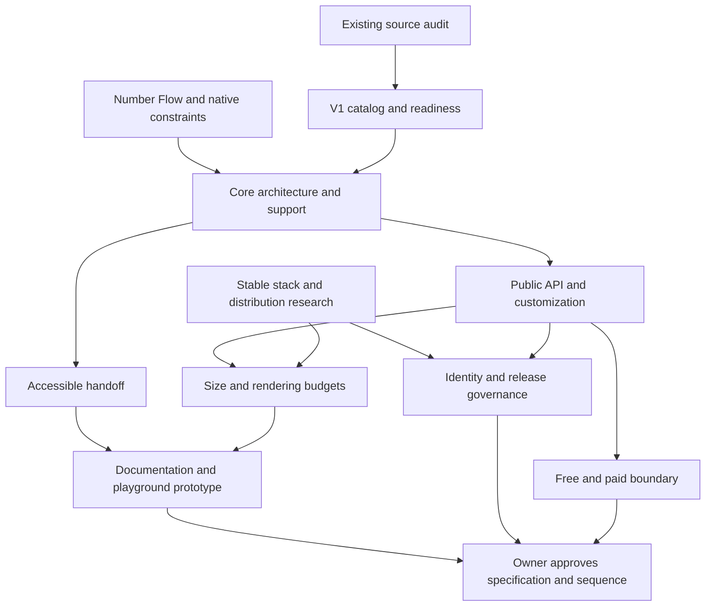

# Dot Loaders product roadmap

The first milestone is a launch-ready specification, followed by a deliberately small, credible v1. Dot Loaders should earn adoption through reliable layout, elegant loading-to-content handoff, useful customization and a tiny framework-independent runtime. A large component count and paid features follow evidence that this foundation works.

This is the proposed implementation sequence, not an accepted API or a delivery-date commitment. The [Wayfinder map](https://github.com/b4rb13/dot-loaders/issues/1) owns the planning effort. Each question is answered only in its ticket; the roadmap groups future delivery work and names its exit criteria. Implementation starts after the owner's specification review.

## Confirmed direction

- Native Web Components at the library foundation, informed by Number Flow's approach; React support through an adapter.
- Bun and Turborepo for the workspace; Next.js, React and Tailwind for the website. Current stable versions are researched, then rechecked and pinned when work starts.
- Composable skeleton primitives plus dot text, chart and table loading surfaces in the initial product. Library-specific integrations follow later.
- Private GitHub development under `b4rb13`; eventual website hosting on `b4rb13's Team` in Vercel.
- An MIT free core with optional paid templates, presets and tooling. Source reuse rights must be checked before copied code is licensed for distribution.
- Read-only treatment of the existing m37 project. Migration into this repository does not migrate or edit its consumers.

## Planning route



Use native GitHub dependencies for the live frontier; this diagram is an orientation view.

| Decision area | Owning ticket |
| --- | --- |
| What is reusable and what needs separation | [Audit the existing loader package for safe reuse](https://github.com/b4rb13/dot-loaders/issues/2) |
| What Number Flow demonstrates and what native elements require | [Investigate Number Flow and native component constraints](https://github.com/b4rb13/dot-loaders/issues/3) |
| Which stable tooling and private-to-public route fit | [Verify the stack and private distribution path](https://github.com/b4rb13/dot-loaders/issues/4) |
| Which surfaces and state transitions v1 promises | [Define the v1 loading experiences and readiness contract](https://github.com/b4rb13/dot-loaders/issues/5) |
| Where rendering, elements and adapters meet | [Choose core boundaries and supported environments](https://github.com/b4rb13/dot-loaders/issues/6) |
| How consumers install, style, compose and extend it | [Define the public API and customization surface](https://github.com/b4rb13/dot-loaders/issues/7) |
| How loading remains understandable and content accessible | [Set accessible loading and content handoff behavior](https://github.com/b4rb13/dot-loaders/issues/8) |
| What measurable lightweight rendering means | [Set measurable size and rendering release budgets](https://github.com/b4rb13/dot-loaders/issues/9) |
| Names, rights, package contents, versions and publishing | [Choose package identity and release governance](https://github.com/b4rb13/dot-loaders/issues/10) |
| Which website and learning experience to build | [Choose the documentation and playground experience](https://github.com/b4rb13/dot-loaders/issues/11) |
| What could become paid, and when | [Define the free product and optional paid expansion boundary](https://github.com/b4rb13/dot-loaders/issues/12) |
| Whether implementation has a complete, coherent specification | [Approve the launch specification and implementation sequence](https://github.com/b4rb13/dot-loaders/issues/13) |

## Milestone 0 — Finish product discovery

Research the inherited code, upstream architecture, standards and stable tooling. Review the v1 catalog and state contract with the owner, choose public boundaries and quality guarantees, explore the docs experience, then approve the resulting specification. Turn any newly exposed essential question into another decision ticket.

**Exit:** every essential decision has a recorded answer and explicit trade-offs; the first implementation slice and release gates are accepted. Research results alone do not pass this gate.

## Milestone 1 — Preserve the source and establish the workspace

After provenance approval, copy only the scoped loader package into an attributed reference snapshot or migration area in this repository. Record its source commit and any relevant uncommitted file hashes, inventory notices, and preserve important behavior examples. Do not inherit organization-specific names, dependencies, source-only exports or application policy by accident.

Create the Bun workspace and Turborepo task graph with a committed lockfile and exact toolchain versions. Proposed boundaries:

```text
apps/
  website/             # Marketing, documentation, examples, playground
packages/
  core/                # Native elements and framework-independent rendering
  react/               # React integration and server-rendering support
  tsconfig/            # Shared internal compiler configuration, if useful
tests/
  consumers/           # Packed-artifact vanilla and React/Next fixtures
benchmarks/            # Repeatable browser scenarios and results
```

Keep renderer internals inside core initially; split another public package only if actual usage justifies another versioned contract. Add optional integrations as separate entry points or packages after measurement and support decisions. Next.js and Tailwind must not become requirements for library consumers.

**Exit:** a clean checkout installs reproducibly; workspace checks/build work; the source project fingerprint is unchanged; the planned public package contents contain no application code or secrets.

## Milestone 2 — Build the smallest complete native loading flow

Implement one representative surface through its entire lifecycle: explicit registration, sizing, rendering, motion preferences, readiness, static fallback and handoff. Preserve or improve the inherited scheduling and resource cleanup where evidence supports reuse. Establish deterministic initialization and a coherent multi-instance policy before adding variants.

Prove the hard cases early: hidden/offscreen surfaces, reduced motion, late fonts, zero-sized containers, reconnects and node moves, interrupted transitions, and multiple copies of the library. Choose bounded canvas resolution and dot density from measured cost, not visual intuition alone.

**Exit:** a vanilla page can install the packed artifact and complete a loading cycle; relevant resources disappear on teardown; static and paused modes remain useful; benchmark fixtures establish honest baselines. No claim of a tiny bundle or smooth large lists without measurements.

## Milestone 3 — Add React and server-rendering support

Build the thin React adapter over the same native runtime. Verify property/event/ref forwarding, strict-mode remounts, registration timing and deduplication, typed customization and lifecycle ownership. Validate the agreed server-safe imports and progressive fallback in a real Next.js consumer, including streamed rendering and hydration.

Reserve layout before JavaScript runs. Decide and test how placeholder and content markup behaves when JavaScript is delayed or unavailable. Prevent document-global mutable server state from crossing requests.

**Exit:** packed-package vanilla and Next.js fixtures work without workspace source transpilation; hydration has no unexpected warnings; content remains accessible under the supported fallback contract; React is absent from the core dependency graph.

## Milestone 4 — Complete the focused catalog and customization

Grow the proven flow into composable block/line/circle/text-shaped skeletons and distinctive text, chart and table surfaces. Keep a structural text skeleton distinct from animated text content. Chart and table surfaces should accept consumer-owned geometry/readiness without pulling a chart or grid library into core.

Provide sensible default palettes, responsive sizing, local theme overrides and motion controls. Prefer a short set of stable customization hooks over exposing every internal field. A custom preset should use the same lifecycle, cleanup, motion and accessibility rules as built-ins.

**Exit:** each agreed surface has a documented contract, meaningful edge-case tests, accessible loading-to-content behavior and consistent customization. No feature depends on a specific application's data-fetching conventions. The agreed non-Latin/RTL/font behavior is visible in docs rather than silently inferred from a Latin bitmap alphabet.

## Milestone 5 — Enforce library quality and release packaging

Quality checks begin with the first flow and expand with each surface. This milestone makes them release gates:

| Area | Evidence required before a release |
| --- | --- |
| Package integrity | Compiled exports and declarations resolve; packed tarball installs in external consumers; published files are intentionally scoped |
| Rendering cost | Per-entry size reports, visible/offscreen/still scenarios, representative device/browser traces and bounded degradation |
| Lifecycle | Repeated mount/unmount, reconnects, preference changes and transition interruptions do not leak or expose stale content |
| Accessibility | Keyboard/focus checks, screen-reader review, motion/pause behavior, forced colors, zoom and busy/announcement semantics |
| Layout | Reserved geometry and font/resize/content-change cases meet the agreed shift contract |
| Compatibility | The supported browsers and React/Next environments pass the actual consumer fixtures |
| Maintenance | Public API/type checks, concise contribution guidance, release notes and documented support boundaries |

Use unit tests for meaningful state/geometry/lifecycle contracts, real-browser tests for browser behavior, and deterministic visual comparisons for supported still states. Avoid brittle animation screenshots and tests that merely repeat implementation. Automated accessibility tools supplement manual assistive-technology checks.

**Exit:** all agreed gates pass against the distributable artifact, not just source imports inside the monorepo. Exceptions require a documented reason and owner decision.

## Milestone 6 — Build the website, docs and playground

Implement the selected experience as one Next.js app unless a real isolation need emerges. Site content can develop alongside the catalog once API boundaries stabilize.

- Landing page: a real interactive loading-to-content example, clear value proposition, honest browser/size statements and a short path to installation.
- Getting started: vanilla and React instructions, explicit registration rules, Next.js setup and a first useful composition.
- Guides: readiness, layout reservation, themes, motion preferences, accessible announcements, custom presets and optional integrations.
- Reference: typed API, attributes/properties/events, CSS hooks, lifecycle/support details and complete defaults.
- Playground: realistic examples with loading/reload/ready controls, reduced-motion and theme previews, useful sizing controls and copyable snippets that run.
- Maintenance: version/release navigation, changelog, migration notes, known limitations and support links.

Build docs from source-controlled content; verify examples against the released API. Put durable playground state into shareable URLs when useful. Start with the lightest docs/search approach that meets the actual information structure. Do not add accounts or paid infrastructure to support free documentation.

**Exit:** a new user can install and customize a surface from the docs; keyboard/touch/mobile behavior works; examples and code snippets pass consumer checks; the docs do not require paid access for core capabilities.

## Milestone 7 — Run a private alpha on the personal Vercel team

Create and link the website project to the verified personal team, using the correct app root and monorepo build/install configuration. Check the GitHub app's access to this private repository, required environment values, preview protection and deployment ownership. A private repository does not itself make a hosted website private.

Test the preview as its intended audience: docs routes, examples, deep links, refreshes, assets and error states. Try the packed package from a clean external fixture and a representative consumer project without modifying m37. Gather feedback on setup difficulty, unclear APIs, useful presets and distracting animation.

**Exit:** the intended reviewers can access the protected preview; the target team and repository are verified; no npm release or repository visibility change occurred accidentally; issues from alpha use are triaged against the release gates.

## Milestone 8 — Prepare and explicitly authorize the public release

Recheck package-name ownership and provenance, finalize MIT notices, set version/changelog/release instructions, and validate the npm publication workflow. Run prerelease consumer checks before choosing a stable v1 tag. Publishing credentials/permissions and provenance must follow current npm guidance and live outside the distributed runtime.

Public npm release, public website exposure, and GitHub visibility are separate choices. Keep repository privacy independent of free-package distribution. Obtain explicit release authorization before changing any of those states. Provide a migration policy, a defined compatibility promise and a straightforward way to report reproducible bugs.

**Exit:** the intended package contents, docs version, source/provenance notices, release notes and quality evidence agree; the owner has authorized the specific publication action. After release, verify installation from npm rather than treating an upload response as sufficient.

## Milestone 9 — Grow the product from real adoption

First deepen useful capabilities: additional documented compositions, better examples, demanded integrations and measured rendering improvements. Add official framework adapters only where native-element consumption leaves a meaningful gap and maintenance capacity exists.

Validate paid value separately. Plausible experiments include polished application templates, curated premium presets, a visual preset builder/exporter, design assets and support. Core accessibility, essential customization, performance fixes and usable docs remain part of the free product. Do not build commerce before users identify something worth purchasing.

Track practical signals: time to first successful example in user trials, recurring integration friction, bug reproduction/resolution time, compatibility and size regressions, requested surfaces, repeated use and willingness to pay. Consumer telemetry is not required; interviews, issue reports and opt-in feedback can inform these decisions.

**Exit for a paid experiment:** demonstrated demand, a bounded deliverable, clear free/paid licensing and support promises, and an owner-approved fulfillment plan. Pricing, subscriptions and accounts remain later decisions.

## Scheduling and scope controls

Do not assign calendar dates until the architecture and baseline cost are known. The implementation critical path is provenance → workspace/distributable → native lifecycle → React/SSR → catalog and quality → private alpha → authorized release. Documentation content can progress once the API is coherent; performance and accessibility checks run throughout.

Avoid three expensive shortcuts: copying the existing source-only React package and calling it public-ready, shipping undocumented global registration/theme behavior, and expanding presets before proving cleanup and rendering budgets. Revisit scope through named decision tickets whenever evidence changes the route.
