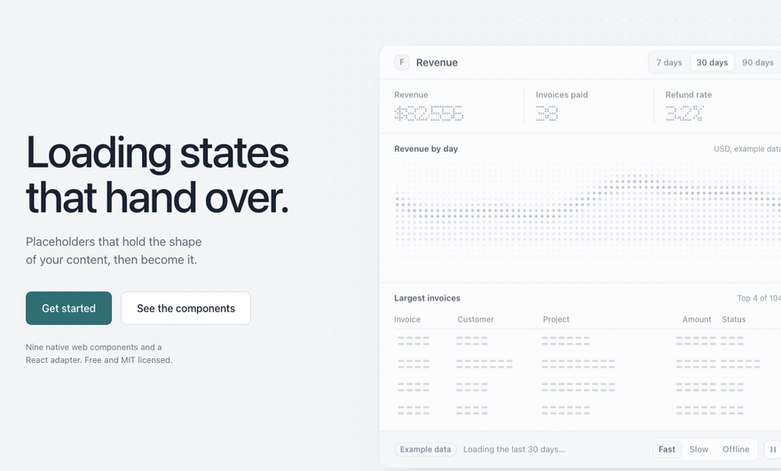

# Dotquilt for Angular

Angular components for [Dotquilt](https://dotquilt.dev): loading placeholders that hold the shape of your content, then hand over to it. They are thin wrappers over the native Web Components in `dotquilt`: each component's host is the native element itself. Server rendering is included: with Angular SSR, placeholders are in the first HTML at your content's size, and hydration keeps them.

<a href="https://dotquilt.dev"></a>

> **Status:** alpha (0.x). The API may still change before 1.0.

## Install

```bash
npm install @dotquilt/angular dotquilt
```

`@angular/core` 22 is a peer dependency. No `CUSTOM_ELEMENTS_SCHEMA` is needed: import the standalone components, and templates are type-checked.

## Quick start

```ts
import { Component, input } from '@angular/core';
import {
  DotquiltPlaceholder,
  LoadingRegion,
  SkeletonText,
} from '@dotquilt/angular';

@Component({
  selector: 'app-summary',
  imports: [DotquiltPlaceholder, LoadingRegion, SkeletonText],
  template: `
    <dotquilt-region aria-label="Revenue" [state]="data() ? 'ready' : 'pending'">
      <div dotquiltPlaceholder><dotquilt-skeleton-text [lines]="3" /></div>
      @if (data(); as revenue) {
        <app-revenue-card [data]="revenue" />
      }
    </dotquilt-region>
  `,
})
export class Summary {
  readonly data = input<Revenue | null>(null);
}
```

Your app owns the request; the region only needs to know whether the data is `pending`, `refreshing` (content stays visible and usable) or `ready`. Give each load a `cycle` so a stale answer can't settle a newer one. Use `delay` and `minDisplay` to keep fast loads from flickering.

## Components

| Component | Use it for |
| --- | --- |
| `LoadingRegion` (`<dotquilt-region>`) | Wraps content: the `dotquiltPlaceholder` element while pending, a refresh cue (or your `dotquiltRefreshIndicator` element) while refreshing, a handoff when ready |
| `SkeletonBlock`, `SkeletonLine`, `SkeletonCircle`, `SkeletonText` | Images, lines, avatars and paragraphs |
| `TextLoader` (`<dotquilt-text-loader>`) | Numbers and short labels that take shape in marks, then hand over; its content is the value, and `mask` gives the placeholder its shape in the server HTML |
| `ChartLoader` | Line, bar and scatter charts; give it a `targetProvider` so marks glide onto your data |
| `TableLoader` | Tables: each cell's marks gather into its real text |
| `TypingDots` | A reply that is being written |

Inputs have the same names as the element options, typed from `dotquilt`. Outputs are `(handoffStart)`, `(handoffEnd)`, `(handoffCancel)` and `(loaderError)`, each with the native `CustomEvent`. A component's `element` is the native element.

The package has one entry; an Angular build keeps only the components you use.

## Server rendering and hydration

- Render the same `state` on the server and in the first client render, so hydration matches.
- The elements register in the browser after rendering. Their styles before that go in the document head once, through Angular's own component styles.
- Without JavaScript, or if it fails, a pending region keeps its still placeholder and your content stays visible and usable.

## Strict CSP

Angular adds the components' styles with its `CSP_NONCE` (or `ngCspNonce`), and the elements use the same nonce for their own styles unless you pass a `stylePolicy`. For an external stylesheet instead, pass `{ mode: 'external', href }` and serve the file from `@dotquilt/angular/styles/*.css`.

## Docs

Guides, every option and live examples are at [dotquilt.dev](https://dotquilt.dev).

## License

MIT
