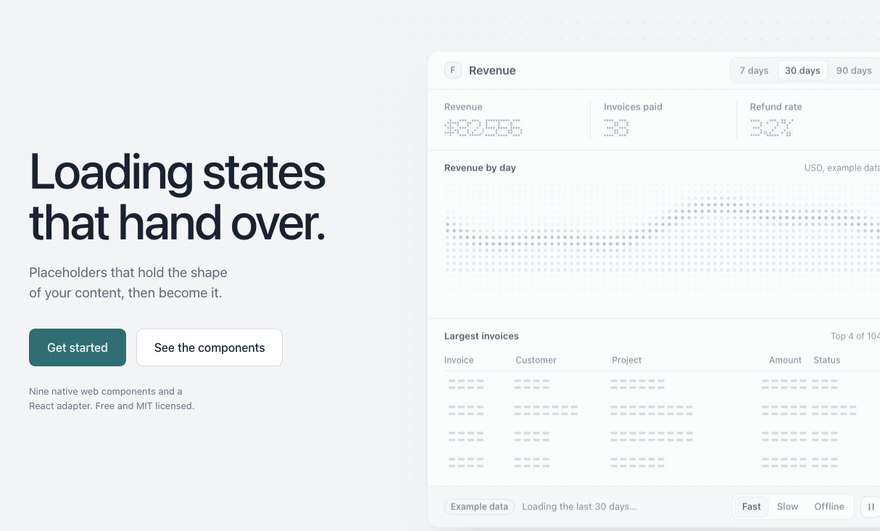

# Dotquilt for Vue

Vue 3 components for [Dotquilt](https://dotquilt.dev): loading placeholders that hold the shape of your content, then hand over to it. They are thin wrappers over the native Web Components in `dotquilt`. Server rendering is included, in Nuxt or your own Vue SSR: placeholders are in the first HTML at your content's size, and hydration leaves your content alone.

<a href="https://dotquilt.dev"></a>

> **Status:** alpha (0.x). The API may still change before 1.0.

## Install

```bash
npm install @dotquilt/vue dotquilt
```

`vue` 3.5 or later is a peer dependency. No Vue or Nuxt configuration is needed: the components register their elements themselves.

## Quick start

```vue
<script setup lang="ts">
import { LoadingRegion, SkeletonText } from '@dotquilt/vue';

defineProps<{ data: Revenue | null }>();
</script>

<template>
  <LoadingRegion aria-label="Revenue" :state="data ? 'ready' : 'pending'">
    <template #placeholder>
      <SkeletonText :lines="3" />
    </template>
    <RevenueCard v-if="data" :data="data" />
  </LoadingRegion>
</template>
```

Your app owns the request; the region only needs to know whether the data is `pending`, `refreshing` (content stays visible and usable) or `ready`. Give each load a `cycle` so a stale answer can't settle a newer one. Use `delay` and `min-display` to keep fast loads from flickering.

## Components

| Component | Use it for |
| --- | --- |
| `LoadingRegion` | Wraps content: the `#placeholder` slot while pending, a refresh cue (or your `#refresh-indicator` slot) while refreshing, a handoff when ready |
| `SkeletonBlock`, `SkeletonLine`, `SkeletonCircle`, `SkeletonText` | Images, lines, avatars and paragraphs |
| `TextLoader` | Numbers and short labels that take shape in marks, then hand over; the default slot is the value |
| `ChartLoader` | Line, bar and scatter charts; give it a `target-provider` so marks glide onto your data |
| `TableLoader` | Tables: each cell's marks gather into its real text |
| `TypingDots` | A reply that is being written |

Props have the same names as the element options, typed from `dotquilt`. Events are `@handoff-start`, `@handoff-end`, `@handoff-cancel` and `@loader-error`, each with the native `CustomEvent`. A template ref on a component exposes the native element as `element`.

Each component is also available from its own entry (for example `@dotquilt/vue/region`), so a page loads only what it uses.

## Server rendering and hydration

- Render the same `state` on the server and in the first client render, so hydration matches.
- The elements register after mount, so they never change markup Vue is hydrating.
- Without JavaScript, or if it fails, a pending region keeps its still placeholder and your content stays visible and usable.

## Strict CSP

Choose a `style-policy` before the first render and pass it to every component:

- **`{ mode: 'inline' }`** (default) writes deterministic `<style>` elements. Allow them with CSP hashes.
- **`{ mode: 'inline', nonce }`** applies your request's nonce.
- **`{ mode: 'external', href }`** points at a stylesheet you serve. Copy it from `@dotquilt/vue/styles/*.css`.

## Docs

Guides, every option and live examples are at [dotquilt.dev](https://dotquilt.dev).

## License

MIT
